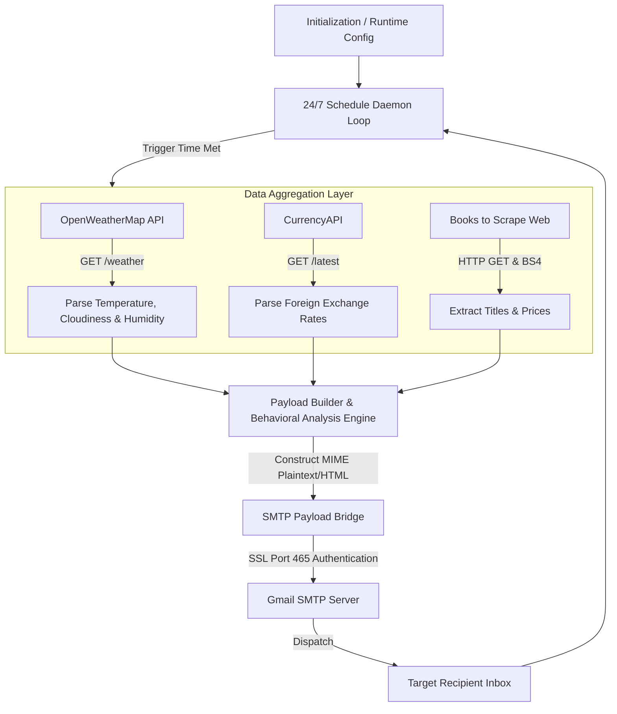

# 🤖 Auto-Gmail Information Engine

[](https://www.python.org/)
[](https://openweathermap.org/)
[](https://www.crummy.com/software/BeautifulSoup/)
[](https://opensource.org/licenses/MIT)

The **Auto-Gmail Information Engine** is an automated Python intelligence daemon designed to aggregate multi-source daily telemetry including live weather analytics, real-time currency exchange rates, and trending bookstore literature. It compiles these disparate data streams into a unified digest and securely routes them to designated recipients via automated SMTP SSL dispatch on a configurable 24/7 schedule.

---

## 2. Core Architectural Diagram

The system operates on an automated loop that integrates live external REST APIs and HTML web scraping endpoints before constructing and delivering an encrypted email payload.




## 3. Technical Stack & Mechanism Breakdown

### Data Source Technology Matrix

| Feature Module | Extraction Mechanism | Provider / Target Endpoint | Returned Data Structure |
| :--- | :--- | :--- | :--- |
| **Weather Analysis** | REST API (`requests`) | OpenWeatherMap API | JSON object containing temperature, humidity, cloud coverage, and weather descriptions. |
| **Currency Rates** | REST API (`requests`) | CurrencyAPI | Nested JSON payload mapped by ISO 4217 currency key codes. |
| **Book Discovery** | Web Scraping (`BeautifulSoup4`) | Books to Scrape (`books.toscrape.com`) | HTML DOM element parsing (`<article class="product_pod">`). |

---

### 4. Deep Mechanics Breakdown

#### Dynamic Weather Logic
The weather engine evaluates raw metrics returned from OpenWeatherMap to dynamically generate contextual behavioral suggestions:
* **Overcast & Precipitation:** Analyzes `clouds['all']` percentages ($> 70\%$) and inspects string conditions for precipitation keywords to flag rain warnings.
* **Atmospheric Comfort:** Evaluates relative humidity ($> 80\%$) and temperature thresholds ($> 30^\circ\text{C}$ for heat, $< 15^\circ\text{C}$ for cold) to append tailored lifestyle suggestions.

#### The SMTP Payload Bridge
Email delivery utilizes Python's built-in `email.message.EmailMessage` and `smtplib` libraries:
1. **Message Assembly:** Plaintext content is mapped into an standardized `EmailMessage` MIME structure containing dynamic envelope headers (`Subject`, `From`, `To`).
2. **Encrypted Transport:** Connects directly over **SMTP_SSL Port 465** directly establishing an encrypted TLS/SSL session from socket initialization, mitigating MITM vulnerabilities during credential transfer and transmission.

#### Continuous Thread Lifecycle
The application acts as a lightweight 24/7 background daemon:
* The core process registers `send_email` using `schedule.every().day.at("08:00")`.
* An infinite execution block (`while True`) continuously checks for pending execution tasks via `schedule.run_pending()`.
* A explicit `time.sleep(60)` delay prevents high CPU core utilization while keeping CPU usage close to $0\%$.

---

## 5. Installation & Runtime Orchestration

### Prerequisites & Dependencies

Provision your runtime environment using `pip`:

```bash
pip install requests beautifulsoup4 schedule
```

---

### 6. Runtime Environment Variables

Configure the following variables directly inside `main.py` before launching:

| Variable Name | Description | Security / Source Context |
| :--- | :--- | :--- |
| `SENDER_EMAIL` | Gmail address used to dispatch emails | Standard Gmail address. |
| `SENDER_APP_PASSWORD` | 16-character Gmail App Password | Requires Google 2FA enabled. Generated via Google Account Security settings. |
| `RECEIVER_EMAIL` | Target destination email address | Any valid email account capable of accepting incoming SMTP mail. |
| `CURRENCY_API_KEY` | API Key for foreign exchange rates | Sourced from [CurrencyAPI](https://currencyapi.com/). |
| `WEATHER_API_KEY` | API Key for meteorological updates | Sourced from [OpenWeatherMap](https://openweathermap.org/api). |

---

### 7. Terminal Execution Instructions

Execute the script directly to launch the background daemon:

```bash
python main.py
```

To run the process in the background on Linux/macOS environments:

```bash
nohup python main.py > engine.log 2>&1 &
```

<p align="center">
  <strong>Authorized by Rayaan Tasnim</strong><br>
  <em>All rights reserved.</em>
</p>
